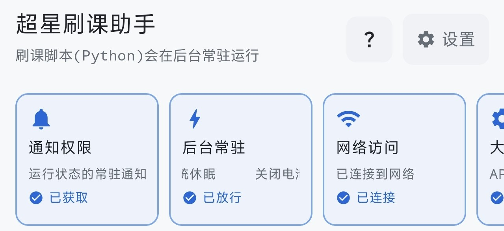
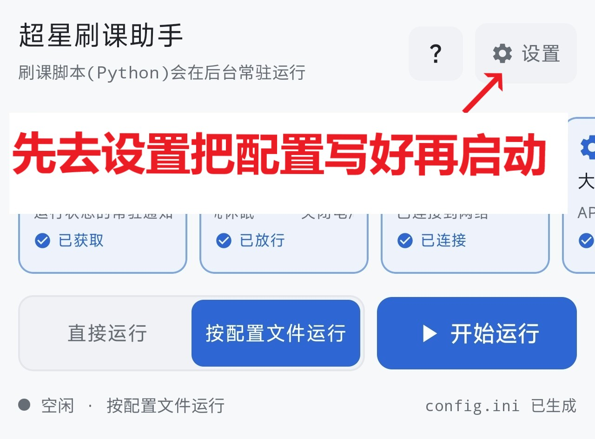
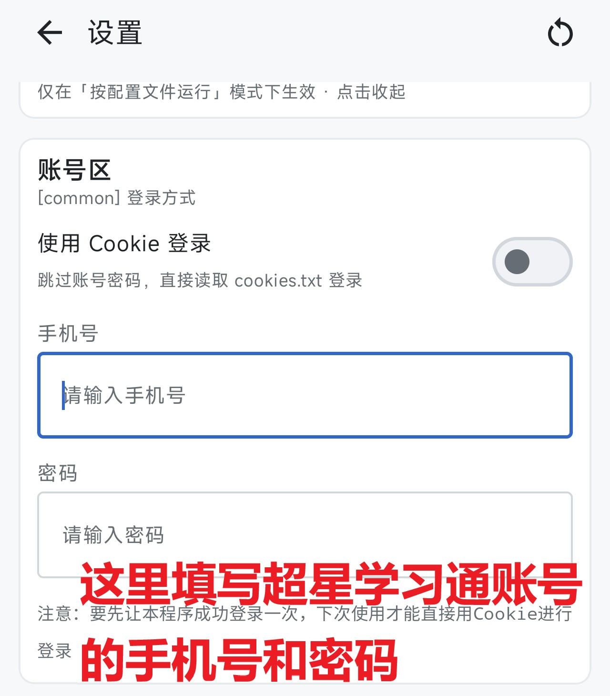
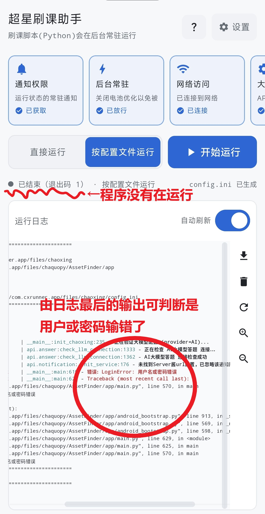
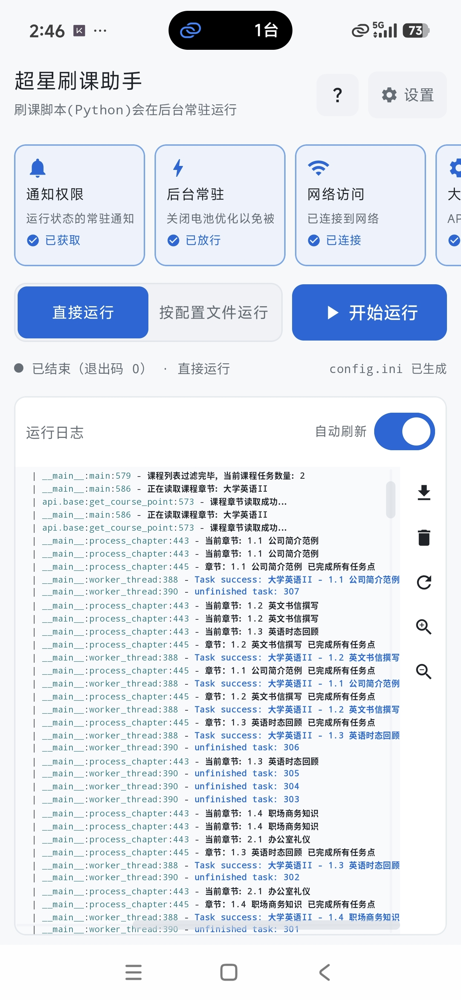
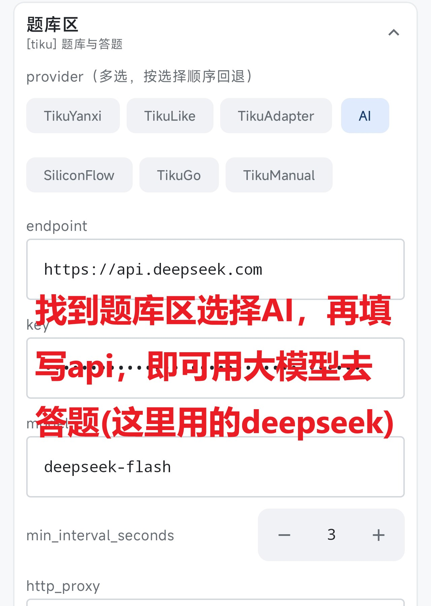
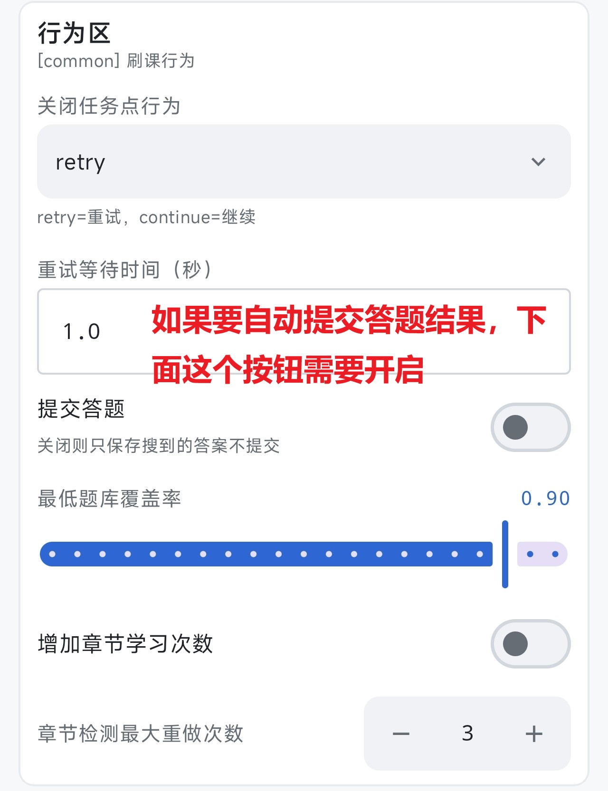
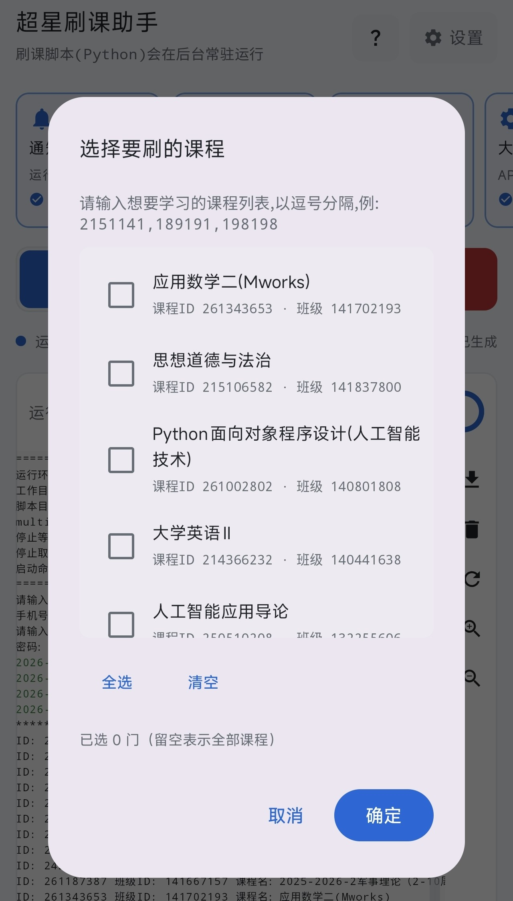

# 帮助文档

超星刷课助手：把开源刷课脚本打包进手机，**不需要电脑、不需要 Root**，打开 APP 就能后台挂机运行。

当前版本：v1.1

<!--
如需配图：把图片放进 app/src/main/assets/help/ 目录，然后在下面写

渲染时会自动从 assets 读取；图片不存在时显示一个占位框。
-->

## 一、快速上手：

1. **开启必要权限**：主页顶部有一排权限卡片，运行该程序需要这些权限，可以逐个都点一下

2. **选择运行模式**：如果只是临时使用一下，选择「直接运行」模式再点击运行，接着按系统提示完成操作即可。
   
   **【推荐】** 使用该程序最好选择「按配置文件运行」模式，以应对长期使用和多功能的需求（比如刷题，通知）。最好先打开设置，填写账号和密码，再选择「按配置文件运行」模式运行，之后就不用再填账号和密码

3. **进程判断**：「开始运行」后，日志区上方会显示进度条。如果开启了刷题，日志区内也可以查看。若运行后出现异常停止任务的情况(退出码不为0)，可以滑动日志至底部查看原因

退出码为0时代表程序正常退出(比如刷课任务完成,用户手动停止等)

5. **AI答题**：如果想自动刷题，必须要调用AI大模型的api。右上角「设置」→「配置文件参数」→「题库区」，选择"AI"，补充三个字段值即可（需要在api开放平台获取）。答题行为需要在「行为区」里设置。

> 登录成功后，会显示课程列表，可以手动选择要刷的课程

## 二、主页说明

- **权限卡片**：横向可滑动，点一下跳到对应的系统设置页；卡片数量会随设置变化（例如勾选了大模型题库，才会出现「大模型配置」卡片）；未成功授权的卡片会优先显示。
- **运行模式**：「直接运行」使用界面里填写的参数；「按配置文件运行」使用生成的 `config.ini`。
- **开始 / 停止**：绿色是开始，红色是停止。停止会在几秒内生效，正在计时的等待会被立刻打断。
- **运行日志**：终端风格等宽字体。右上角开关控制自动刷新；右侧竖排按钮从上到下依次是
  导出、清空、刷新、放大、放小。

## 三、设置面板

设置项按功能分成几个卡片，改完即时保存：

- **界面与运行**：UI 主题（黑色 / 白色 / 跟随系统）、日志字号、运行模式。这一张始终显示在最上面。

下面这些都只在「**按配置文件运行**」模式下生效，所以统一收进一个叫
「**配置文件参数**」的收纳栏里（默认收起，把运行模式切成「按配置文件运行」时会自动展开）：

### 定时启动功能
- 可以设置**开始时间**和**结束时间**，到时会自动启动脚本开始刷课
- 如果课程列表为空，到时启动时会默认刷全部课程

### 配置文件参数
- **账号区**：手机号、密码，或用 `cookies.txt` 登录。
- **课程区**：课程 ID 列表、播放倍速、同时进行的章节数。
- **行为区**：关闭任务点时的行为、重试等待时间、是否提交答题、最低题库覆盖率、章节重做次数。
- **题库区**：题库来源（多选）与各自的 Key。
- **通知区**：Server酱 / Qmsg / Bark / Telegram 推送。
- **配置文件**：预览或编辑 `config.ini`，或一键恢复默认。

最底部还有 **恢复出厂设置**：二次确认后会清空全部设置、日志与运行产物。

## 四、题库与自动答题

题库来源可以多选，脚本会按你勾选的**先后顺序**依次回退查询，前面的查不到就用后面的。

1. `TikuYanxi` / `TikuLike`：需要填写 `tokens`
2. `TikuAdapter`：需要自建服务的地址
3. `AI`：任意兼容 OpenAI 接口的 `endpoint` + `key` + `model`
4. `SiliconFlow`：硅基流动的 `siliconflow_key`
5. `TikuGo`：需要 `go_authorization`
6. `TikuManual`：运行到题目时弹出输入框，手动填答案

> 想让脚本真正把答案交上去，记得打开「提交答题」；如果答案经常不全，把「最低题库覆盖率」调低一些。

## 五、日志与导出

- 脚本自己的日志写在 `chaoxing.log`；APP 日志窗口读的是 `run.log`，两者内容基本一致。
- 点日志区右侧的下载图标，可以把当前日志导出到手机「下载」目录。
- 日志存在 APP 私有目录里，不会占用多少存储空间。

## 六、常见问题
**Q：这玩意不会有病毒吧？**

这是开源项目，所有代码都公开在仓库里，任何人都可以查看、审计、自行编译。所以不用为此担忧。

**Q：`cookies.txt` 里的 Cookie 是哪里来的？怎么才能用 Cookie 登录？**

**先用手机号 + 密码成功登录一次**，脚本会自动把当次的登录
cookie 写进工作目录的 `cookies.txt`，之后「使用 Cookie 登录」，脚本就会改为读这个文件；
注意 Cookie 可能会过期， 失效时脚本会提示「cookies 已失效」，重新用账号密码登录一次即可刷新。

**Q：切到后台一会儿就停了？**

检查主页的「后台常驻」卡片状态是否正常(省电策略为「无限制」)，如果仍未解决，在系统设置里允许本应用自启动。

**Q：课程列表是空的？**

课程列表来自登录后接口的返回，请先确认登录是否成功（日志里会有明确提示）。

**Q：想彻底重来一次？**

设置页最底部有「恢复出厂设置」，二次确认后会清空所有设置、日志与运行产物。

**Q：最新的程序如果有bug应该怎么反馈？**

可以在该项目的github仓库上拉取issue提交反馈，反馈时最好标注手机的系统参数(Android版本,手机型号等)

## 七、免责声明与来源

本 apk 基于开源项目 Samueli924/chaoxing 打包，仅供学习交流，禁止用于盈利或商业用途。使用本工具产生的任何后果由使用者自行承担，与原作者及打包者无关。

源码地址：https://github.com/Samueli924/chaoxing

apk源码地址：https://github.com/WannaBeCute/chaoxing-apk
